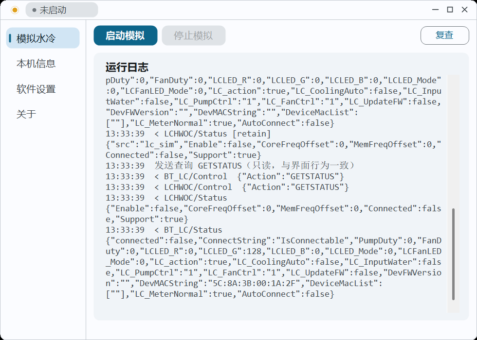

# 虚拟水冷坞 · WaterCoolSim


> 让 **机械革命控制中心（ControlCenterX）** 认为「水冷已连接」的本地模拟器。
> 单文件 exe、零第三方依赖、界面用 Material 3（Monet 动态取色）自绘。



## 它做什么

在同一台机器上运行的本程序，通过本机 MQTT broker（`127.0.0.1:13688`，由控制中心的 `GCUBridge.exe` 提供）发布/保持水冷状态报文，
让控制中心界面显示「水冷已连接」。可用于：没有接水冷坞时演示界面、排查控制中心的水冷相关逻辑、做界面联调。

**它不做什么**：

- 不写驱动、不注入进程、不改控制中心的任何文件或安装目录；
- 不伪造硬件；只与本地 broker 收发 MQTT 报文；
- 停止/关闭时自动把状态**覆盖回「未连接」**，并只清理自己发过的 retained 消息（带 `"src":"lc_sim"` 标记的记录）。

## 原理

控制中心的 UI 进程通过 MQTT 与本机 broker 通信，水冷的判定链路大致是：

| 主题 | 作用 |
|---|---|
| `BT_LC/Status` | 水冷坞状态。含 `connected`（小写键名）、`ConnectString`（`Connected` / `IsConnectable` / `Disconnected`）、`DevFWVersion`、`DeviceMacList` 等 |
| `BT_LC/Control` | 控制指令（`{"Action":"GETSTATUS"}` 等） |
| `LCHWOC/Status` | 水冷超频（HWOC）开关状态：`Enable` / `Connected` / `Support` |
| `LCHWOC/Control` | HWOC 控制指令 |
| `Settings/DeviceSwitchItemStatus` | 设备开关状态（无线/蓝牙/摄像头等） |

本程序按这套报文格式发布（保留位 retained），并在启动/停止时做自检与清理。
broker 对 clientId 有白名单校验，本程序会自动在若干编号间回退尝试。

## 功能

左侧四个页面：

| 页面 | 内容 |
|---|---|
| **模拟水冷** | 启动/停止模拟、6 秒自动复查、运行日志（实时报文） |
| **本机信息** | 系统/硬件（WMI）、GCUBridge 状态、水冷门禁注册表项、.NET 版本、环境自检结果、托盘与自启动状态 |
| **软件设置** | 主机/端口/clientId 编号/重发间隔/MAC/固件版本 + 托盘、开机自启、自启动同时模拟、启动清理、压制真实上报 |
| **关于** | 技术栈、参考的开源项目与许可 |

其它特性：

- 启动时**自动识别水冷 broker 端口**（枚举本机监听端口 + 逐个 MQTT 实连验证，命中后记住；控制中心没开时回退默认端口）；
- 启动时**自动环境自检 + 自动测试连接（只读）**，有问题弹提醒（可选择继续）；
- 关闭窗口可选择「最小化到托盘 / 直接关闭」，可记住选择；托盘图标自己登记（含 `TaskbarCreated` 重登记与 Win11 常显提升）；
- 无边框窗口、圆角边框、自制窗口按钮、非线性动画（OutCubic/OutBack/InOutCubic）；
- 配色用 **Material 3 官方链路**：CAM16 + HCT → TonalPalette → SchemeTonalSpot，主色从桌面壁纸提取（HCT 打分选色）；
- 日志同时落盘到 exe 同级目录的 `WaterCoolSim.log`，便于事后核对。

## 构建

只需要系统自带的 .NET Framework 4.x（`csc.exe`），**不需要 Visual Studio、不需要任何第三方库**：

```bat
build.cmd                 :: 生成 dist\虚拟水冷坞.exe